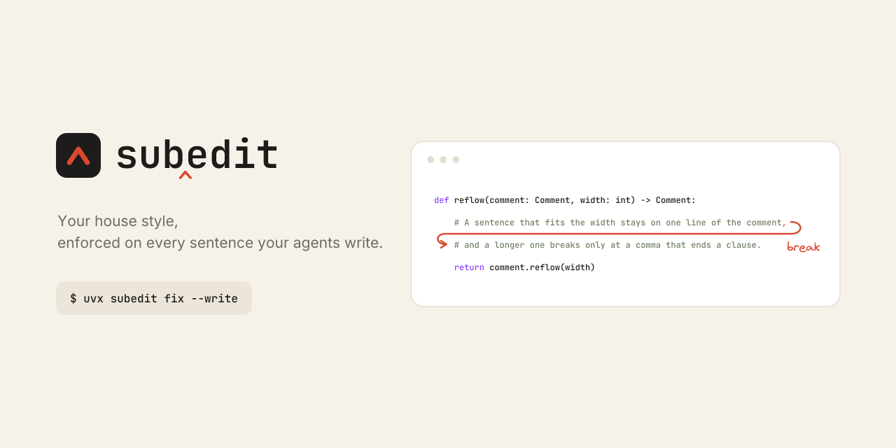

<p align="center">
  <a href="https://github.com/mroops0111/subedit/actions/workflows/ci.yml"></a>
  <a href="https://pypi.org/project/subedit/"></a>
  <a href="https://pepy.tech/projects/subedit"></a>
  <a href="https://pypi.org/project/subedit/"></a>
  <a href="#agent-integration"></a>
  <a href="LICENSE"></a>
</p>

Linters keep an agent's code in shape. Almost nothing does the same for its sentences. `subedit` is a subeditor for AI agents. It checks every sentence an agent writes into your repository, autofixes the layout without a word, and hands back to the model only what needs rewriting, with the fix stated. [Surfaces](#surfaces) lists the kinds of text it reads, comments, Markdown, and commit messages.

- **Built for Agents**: a hook for Claude Code and Codex checks what an agent writes, each file it edits and each commit it makes, as it lands.
- **Silent Autofix, Stated Rewrites**: layout and spacing are autofixed without a message, and only a finding that needs the sentence's meaning goes back, with its fix stated.
- **Sentence-Aware Layout**: a comment and a commit message body break only at a comma that ends a clause, and a Markdown paragraph stays on one line.
- **Never Touches Code**: tree-sitter finds the prose, so code, string literals, and commented-out code are left as they are.
- **One Report, Three Engines**: native layout and structure rules, a bundled Vale style, and AutoCorrect share one config and one report.

---

## Example

An editor wraps a comment at whatever column it reaches, so sentences break mid clause.

```python
def reflow(comment: Comment, width: int) -> Comment:
    # A sentence that fits the width stays on one line of the comment, and a longer
    # one breaks only at a comma that ends a clause.
    return comment.reflow(width)
```

`subedit fix --write` autofixes the layout and says nothing. The sentence is too long for one line, so it breaks at the comma where its first clause ends.

```python
def reflow(comment: Comment, width: int) -> Comment:
    # A sentence that fits the width stays on one line of the comment,
    # and a longer one breaks only at a comma that ends a clause.
    return comment.reflow(width)
```

Markdown has no column limit, yet an agent often wraps a paragraph by hand, and GitHub, Notion, and Heptabase may show each of those newlines as a break.

```markdown
## cache layout

The cache keeps one entry per file,
and drops it when the file changes.
```

The same command joins the paragraph into one line and puts the heading in Title Case, again without a word.

```markdown
## Cache Layout

The cache keeps one entry per file, and drops it when the file changes.
```

A sentence in a comment that runs past the width with no comma has nowhere legal to break, and only its author knows where the meaning divides, so it goes back to the agent that wrote it.

```text
1 finding needs rewriting in src/cache.py.
Each states the fix. Apply it in place, do not add a suppression comment.

line 2  [unbreakable-sentence]
  This sentence runs to 116 characters against a budget of 114 characters and contains no comma, so there is no legal place to break it. Add a comma at a clause boundary, or split it into two sentences.
```

## Getting Started

`subedit` runs inside an AI agent as a plugin, and on its own from the command line.

### Claude Code Plugin

The plugin needs only [uv](https://docs.astral.sh/uv/). It runs `subedit` from PyPI with Vale included, and warms that environment when a session starts.

```text
/plugin marketplace add mroops0111/subedit
/plugin install subedit@mroops
```

The hook then acts in every project that opts in with a `subedit.toml`, which may be empty. [Agent Integration](#agent-integration) covers Codex and registering the hook by hand.

### Command Line

The command line tool needs Python 3.11 or newer, and installs from PyPI.

```bash
uv tool install 'subedit[vale]'   # recommended, fetches Vale for you
uv tool install subedit           # without Vale, the native rules and AutoCorrect still run
```

`pipx install subedit` and `pip install subedit` work as well. To try it without installing, prefix any command with `uvx`.

### Quick Start

Every command takes files or directories, and a directory walk skips dotted and vendor directories such as `.venv` and `node_modules`.

| Command | What It Does |
| --- | --- |
| `subedit check src/` | Reports every finding |
| `subedit check src/ --output=actionable` | Reports only the findings that need rewriting |
| `subedit check src/ --output=json` | Reports every finding as JSON, for other tools |
| `subedit fix src/` | Shows the autofixes as a diff |
| `subedit fix src/ --write` | Applies the autofixes in place |
| `subedit stats src/` | Measures comment lengths and widths, to set thresholds from data |
| `subedit rules` | Lists every native rule with its fix kind and default level |
| `subedit install-hook` | Installs git hooks that lay out the staged files and the commit message |
| `subedit fix --staged --write` | Applies the autofixes to the files git has staged |

To adopt `subedit`, add an empty `subedit.toml` at the project root, run `fix --write` once, and read what `check` still reports. `check` exits 1 on any `error` finding, and `fix` exits 1 while an `error` rewrite remains, so both drop into CI, and [Git Hooks](#git-hooks) runs them on each commit. `--no-delegate` skips Vale and AutoCorrect.

<details>
<summary><b>CI Workflow</b>: a GitHub Actions job</summary>

<br>

```yaml
# .github/workflows/prose.yml
jobs:
  subedit:
    runs-on: ubuntu-latest
    steps:
      - uses: actions/checkout@v4
      - uses: astral-sh/setup-uv@v6
      - run: uvx --from 'subedit[vale]' subedit check src/
```

</details>

## Background

A subeditor is the editor at a newspaper who makes every article follow the paper's style guide. `subedit` does that for the text AI agents write in your repository.

Agents write a lot of comments, docs, and commit messages, and rarely go back to check them. Code formatters skip prose, and prose linters don't understand source files or git, so three kinds of problems slip through:

- **Layout**: comments and commit messages are wrapped at a fixed column, and Markdown paragraphs by hand, so sentences break in the middle of a phrase.
- **Form**: a public function gets a plain comment instead of a docstring, a heading asks a question, and a commit subject runs past what `git log` shows.
- **Wording**: change history and ticket numbers end up in comments and go out of date, and punctuation drifts from the house style.

Telling the agent isn't enough. Even with a style guide or a skill, agents get layout rules wrong and forget them as the conversation grows. A tool that checks every edit doesn't forget, and by fixing what it can itself, it keeps fifty layout complaints out of the agent's context.

## Design

Every finding says who can resolve it, and the whole design turns on that answer.

### Fix Kinds

A rule declares one of three fix kinds, which decides what changes and who makes the change.

| Kind | What Changes | Resolved By | Example |
| --- | --- | --- | --- |
| `TARGETED` | A few characters, in place | The tool, silently | A missing space between CJK and Latin text |
| `REFLOW` | Where lines break | The tool, silently | A sentence broken mid clause |
| `REWRITE` | The wording itself | The author | A sentence too long to break anywhere legal |

Targeted and reflow fixes are autofixes, applied without a message. Only a rewrite reaches the author, because changing the wording needs the sentence's meaning.

### Severity

A level decides whether a rewrite blocks. Every rule has a default, and every rule can be moved between levels or switched off.

| Level | `check` and `fix` | Agent Hook |
| --- | --- | --- |
| `error` | Fails with exit code 1 | Blocks the edit and sends the message to the model |
| `warning` | Shows the message as advice | Sends the message as context, without blocking |
| `off` | Skips the rule | Skips the rule |

Judgment rules, such as a long block or a date in a comment, default to `warning`.

### Layout Model

Reflow works on sentences rather than lines, so the result reads the way the author would have broken it.

- **One Line When It Fits**: a sentence that fits takes one line, and a wrapped one that would fit is joined.
- **Clause Commas Only**: a longer sentence breaks only at a comma that ends a clause, never inside brackets or a code span, and preferably not inside a list.
- **No Short Lines**: no break leaves a line shorter than the `line-too-short` floor, 24 characters by default.
- **Verbatim Blocks**: code examples, docstring sections, and JSDoc tags are left as written.
- **Markdown Paragraphs**: Markdown has no column limit, so a paragraph takes one source line, and a hand-wrapped one is joined.

### Pipeline

A file takes the same path through `subedit` whether the CLI or the agent hook started it.


1. **Resolve**: the closest `subedit.toml`, or `[tool.subedit]` in `pyproject.toml`, gives the rules and the width.
2. **Parse**: each surface's parser finds the prose, such as comments and docstrings, headings and paragraphs, or a commit's subject and body, and maps where code sits. A Markdown code block is read as its own language when the project sets `code-blocks` for Markdown.
3. **Lint**: each native rule reads its own surface, and a Vale or AutoCorrect finding is kept only inside prose.
4. **Autofix**: targeted edits, then reflow, rerun until nothing mechanical is left, for up to ten rounds.
5. **Report**: what remains is a rewrite, reported as a blocking error or as advice.

### Architecture

The package follows a layered design, so a new language, rule, or delegated tool is one class behind an existing port.


Rules never see a syntax tree. A parser turns the file into prose units, such as a comment group with the symbol it documents, a Markdown paragraph, or a commit subject, and each rule reads the units of its own surface. A new surface is a `ProseUnit` with its `SourceParser`, and text an agent writes through the shell, as `git commit` does, reaches the hook through a `ShellWatcher`. A new language is a `LanguageProfile`, a format whose only prose is its line comments is one more `CommentOnlyProfile`, and a new agent is an `AgentHarness`.

## Reference

### Agent Integration

`subedit-hook` checks what an agent writes, on every surface alike. It runs after each file the agent edits, and after each shell command that writes prose, such as `git commit`. It applies the autofixes in place where it can write them, and exits 2 only when a sentence needs rewriting, which hands the message back to the model. A commit is already made, so the hook never amends it. It hands the laid out message back instead, for the agent to amend a commit it has not pushed. A warning reaches the model too, as context beside the tool result, without blocking.

The hook acts only in a project that opts in, with a `subedit.toml` or a `[tool.subedit]` table in `pyproject.toml`, in the written file's directory or a parent. An empty table is enough. Elsewhere it exits 0 and changes nothing. The opt-in covers every surface. A surface is switched off under `[surfaces]`, and a single rule by name under `[rules]`.

A session that opens in such a repository, with no [git hooks](#git-hooks) running subedit, hears once that `subedit install-hook` would add them, and the agent runs it only if you agree.

#### Claude Code

The [plugin](#claude-code-plugin) registers the hook for you. It also ships the `subedit:judging-findings` skill, which gives the model the criteria for every finding a tool cannot fix, such as when a spec identifier stays and a ticket number goes. Criteria in your `CLAUDE.md`, `AGENTS.md`, or a skill of your own come first.

<details>
<summary><b>Manual Hook Registration</b>: without the plugin</summary>

<br>

With `subedit` installed as a tool, add this to `.claude/settings.json`.

```json
{
  "hooks": {
    "PostToolUse": [
      {
        "matcher": "Edit|Write|MultiEdit|NotebookEdit|Bash",
        "hooks": [{ "type": "command", "command": "subedit-hook" }]
      }
    ],
    "SessionStart": [{ "hooks": [{ "type": "command", "command": "subedit-hook" }] }]
  }
}
```

</details>

#### Codex

Add this to `~/.codex/hooks.json`.

```json
{
  "hooks": {
    "PostToolUse": [{ "command": "subedit-hook" }],
    "SessionStart": [{ "command": "subedit-hook" }]
  }
}
```

Registering the hook with both agents is fine, since each payload identifies its sender and anything else exits 0 untouched. `subedit-hook --help` prints the payload shapes it accepts.

### Git Hooks

Text written outside an agent, by a person or another tool, is checked when it is committed. `subedit install-hook` installs two git hooks, and leaves a hook another tool holds alone.

- **pre-commit**: lays out the staged files of every surface, and stops the commit until the laid out files are staged again, or on what needs rewriting.
- **commit-msg**: lays out the commit message in place, and stops the commit on what needs rewriting.

Both run `subedit fix --write`, on the staged files with `--staged` and on the message file git names. With [pre-commit](https://pre-commit.com), each is one entry instead, and `subedit install-hook` prints them in a project that has a `.pre-commit-config.yaml`.

```yaml
repos:
  - repo: https://github.com/mroops0111/subedit
    rev: v0.6.0
    hooks:
      - id: subedit
      - id: subedit-commit-msg
```

`pre-commit install --hook-type pre-commit --hook-type commit-msg` then enables them.

### Configuration

Settings come from `subedit.toml`, or from `[tool.subedit]` in `pyproject.toml`, whichever sits closest above the file being checked. Without either, `check` and `fix` run with the defaults. A config with a misspelled key, level, or option stops subedit with an error that names the file and the key, so a typo never leaves a project on defaults it did not choose.

A rule takes one of two forms, depending on whether it has options to set.

- **Level Only**: a string, `"error"`, `"warning"`, or `"off"`. Every rule takes this form, including the delegated Vale and AutoCorrect rules.
- **Level and Options**: a `[rules.<name>]` table, holding `severity` and the rule's options. Leave out `severity` to keep the default level. The [rule reference](docs/rules.md) lists each rule's options with their defaults.

```toml
[subedit]
line-width = 100
exclude = ["tests/fixtures/**"]

[rules]
mid-clause-break = "warning"
file-header-comment = "off"
"subedit.DateRef" = "off"

[rules.comment-too-long]
severity = "error"
max-plain-lines = 3

[rules.line-too-short]
min-line-characters = 30

[rules.heading-title-case]
exceptions = ["npm"]
```

A name Title Case must leave as written, such as `npm`, goes under `exceptions`, which headings, table headers, and list labels all follow.

Every surface is read once a project adopts subedit, and each is set the same way. The surfaces are `comments`, `markdown`, and `commit-messages`, and the [rule reference](docs/rules.md) names the surfaces each rule reads.

- **Every Surface**: `[rules]` sets a rule on each surface it reads, such as `mid-clause-break` on comments and commit messages.
- **One Surface**: a `[surfaces.<name>]` table sets one surface apart, with the settings below and a `rules` table laid over `[rules]`. A surface's entry for a rule replaces the project's, except that a table's options join those of the project's table.
- **Off**: a surface is switched off as a rule is, with `"off"` under `[surfaces]`, and nothing reads it then.
- **Code Blocks**: a Markdown code block follows the surface of its language, so a Python block follows `comments`.

```toml
[rules]
line-too-short = "off"

[surfaces]
commit-messages = "off"

[surfaces.markdown]
code-blocks = true

[surfaces.markdown.rules]
heading-title-case = { style = "chicago" }
```

In `pyproject.toml`, the same keys sit under `[tool.subedit]`, `[tool.subedit.rules]`, `[tool.subedit.rules.<name>]`, `[tool.subedit.surfaces]`, and `[tool.subedit.surfaces.<name>]`.

<details>
<summary><b>Settings</b>: the width, excluded paths, abbreviations, and what each surface sets</summary>

<br>

`[subedit]` holds the settings for every surface.

| Key | Type | Default | Meaning |
| --- | --- | --- | --- |
| `line-width` | Integer | Each surface's own, below | The column a line laid out against a width must fit, counting indent and delimiter |
| `exclude` | List of globs | `[]` | Paths a directory walk skips, relative to the config file |
| `abbreviations` | List of strings | `[]` | Abbreviations whose period ends no sentence, each written with its period and its case, such as `"Dept."` |

`[surfaces.<name>]` holds the settings for one surface, over those for every surface.

| Key | Type | Default | Meaning |
| --- | --- | --- | --- |
| `line-width` | Integer | The surface's own, below | The width for this surface alone |
| `code-blocks` | Boolean | `false` | Whether the code blocks this surface holds are read, each as a file of its language, which only Markdown holds |
| `rules` | Table | `{}` | Rules set for this surface alone, laid over `[rules]` |

A surface's own width applies unless the project sets one. A width chosen for code, as `[subedit] line-width` is, leaves a commit message at git's width, so only `[surfaces.commit-messages]` changes that.

| Surface | Own Width |
| --- | --- |
| `comments` | The formatter's, `line-length` for ruff or black, `printWidth` for Prettier, or `lineWidth` for Biome, else 120 |
| `markdown` | None, since a paragraph takes one source line |
| `commit-messages` | 72, git's convention |

</details>

### Rules

`subedit` ships 25 native rules, a bundled Vale style of 5 rules, and AutoCorrect. Every rule is set by name under `[rules]` to `"error"`, `"warning"`, or `"off"`, or for one surface under `[surfaces.<name>.rules]`, and its fix kind follows [Fix Kinds](#fix-kinds).

The surfaces share one house style, and differ where their forms differ. A comment and a commit message are laid out against a width, while Markdown has none and is built from paragraphs and headings. A comment sits beside the code it explains, and a commit message tells a change.

| Concern | `comments` | `markdown` | `commit-messages` | Rules |
| --- | --- | --- | --- | --- |
| Punctuation | No mid-sentence colon, semicolon, dash, or arrow | Same | Same | [Style](docs/rules.md#style), [Wording](docs/rules.md#wording) |
| Parentheses | Half-width, spaced outside, flush inside | Same | Same | [Style](docs/rules.md#style) |
| List Labels | Title Case, and bold only in docstrings and JSDoc | Title Case and bold | Title Case | [Style](docs/rules.md#style) |
| Word Choice | The house verb for *include*, and no *not A, but B* framing | Same | Same | [Style](docs/rules.md#style) |
| CJK Spacing | A space between CJK and Latin text | Same | Same | [Spacing](docs/rules.md#spacing) |
| Line Breaks | Within the width, only at clause commas | One source line per paragraph or list item | Within the width, only at clause commas, and a blank line under the subject | [Layout](docs/rules.md#layout) |
| Long Sentences | Rewritten when no clause comma can carry the break | Not checked, since no line breaks | Same as comments | [Sentence](docs/rules.md#sentence) |
| Structure | A docstring on each public symbol, no banner, no restated signature, and a short block | A lead sentence under each heading that opens a list | Not checked | [Structure](docs/rules.md#structure) |
| Titles | None | Headings and table headers in Title Case, not bold, and a noun phrase | A subject that fits, follows the project convention, ends with no period, and gives an instruction | [Titles](docs/rules.md#titles) |
| Stale References | No change narration, ticket number, or date | Not checked, since a note may tell a history | Not checked, since a commit tells one | [Wording](docs/rules.md#wording) |

The [rule reference](docs/rules.md) lists every rule by concern, with the surfaces it reads, what it catches, its default level, and its options.

### Surfaces

A surface is a kind of text where prose lives, named in config as below. Every surface goes through the same pipeline, and each leaves alone what is not prose.

| Surface | Read From | Focus |
| --- | --- | --- |
| `comments` | The comments and doc comments of each [language](#comments) | Layout, because a comment must fit a column limit |
| `markdown` | `.md` and `.markdown` files | One line per paragraph and the shape of headings, because Markdown has no column limit |
| `commit-messages` | The files git writes a message to, such as `COMMIT_EDITMSG` | A subject that fits and follows the project convention, and a body laid out by clause within git's width |

Editor diagnostics over LSP are planned, so the same findings show as you type.

#### Comments

Each language is a profile that knows its comment forms, its doc comment, and what counts as public. A data format has no doc comment or public symbol, so only the rules on wording and layout apply to its comments.

| Language | Files | Doc Comment | Public Symbol |
| --- | --- | --- | --- |
| Python | `.py`, `.pyi` | Docstring, `"""` | A name without a leading underscore |
| TypeScript | `.ts`, `.mts`, `.cts`, `.tsx` | JSDoc, `/** */` | An exported symbol, and its members unless `private`, `protected`, or `#named` |
| JavaScript | `.js`, `.mjs`, `.cjs`, `.jsx` | JSDoc, `/** */` | A symbol exported with `export`, and its members unless `#named` |
| YAML | `.yml`, `.yaml` | None | None |
| JSON | `.json`, `.jsonc` | None | None |

<details>
<summary><b>Content Left Alone</b>: what every profile skips</summary>

<br>

- **Commented-Out Code**: a comment line the language's own grammar reads as code, such as `// return result` or `# client.send(`, is left as written. In YAML and JSON, a setting commented out, such as `# timeout: 30` or `// "semi": false,`, is too.
- **Doc Sections**: a docstring's sections from `Args:`, `Parameters`, or `:param` onward, and a JSDoc block's tags from the first one such as `@throws` onward, are left as written. A JSDoc block keeps its frame when reflowed.
- **Directives**: a directive such as `// eslint-disable-next-line`, `# type: ignore`, or `# yaml-language-server:` carries no prose, so nothing reads it.
- **Plain Blocks**: a plain `/* */` block is usually a license header or code switched off, so nothing reads it.
- **Code and Values**: Vale and AutoCorrect findings are kept only inside comment prose, so a string in code or a value in YAML is never changed.
- **Group Headings**: a plain comment opening a paragraph over several declarations heads them as a group, so it documents none of them.

</details>

#### Markdown

Markdown is read from its paragraphs, list items, headings, and the header of each table.

- **Front Matter, Code, and HTML**: front matter, code, and HTML blocks are left alone.
- **Table Cells**: a table is read only for its header, since its cells are fragments rather than sentences.
- **Code Blocks**: with `code-blocks = true` under `[surfaces.markdown]`, the comments in a fenced block are read too, when its info string names a language subedit supports, such as `python`, `ts`, or `yaml`. Each block is checked as a file of that language would be, by Vale and AutoCorrect as well, except for the rules on a whole file. A code block is often an example, so this stays off unless the project asks.

#### Commit Messages

A commit message is read from its subject and its body. The body breaks between clauses within 72 characters rather than filling each line, which git's convention allows, since it sets a limit on a line rather than a fill.

- **Trailers**: the last paragraph, when every line is a trailer such as `Co-authored-by:` or `Closes #105`, is left alone.
- **Comments**: the comments git adds, from the first line opening with `#`, and the scissors line below them, are left alone.
- **Prefix**: a Conventional Commits type or a kernel subsystem before the description is kept apart from the prose.

## License

[MIT](LICENSE). The English abbreviations that end no sentence come from the [Unicode CLDR](https://cldr.unicode.org/) under the Unicode License v3, whose notice ships with the [data file](src/subedit/domain/models/cldr_sentence_suppressions.txt).
