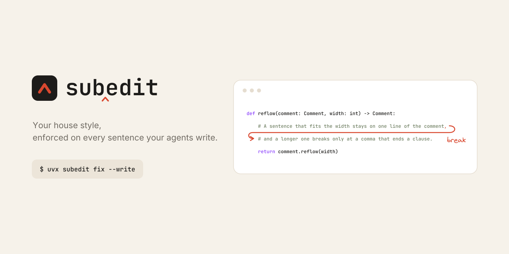

<p align="center">
  <a href="https://github.com/mroops0111/subedit/actions/workflows/ci.yml"></a>
  <a href="https://pypi.org/project/subedit/"></a>
  <a href="https://pepy.tech/projects/subedit"></a>
  <a href="https://pypi.org/project/subedit/"></a>
  <a href="#agent-integration"></a>
  <a href="LICENSE"></a>
</p>

Linters keep an agent's code in shape. Almost nothing does the same for its sentences. `subedit` is a subeditor for AI agents. It checks every sentence an agent writes into your repository, autofixes the layout without a word, and hands back to the model only what needs rewriting, with the fix stated. [Surfaces](#surfaces) lists the kinds of file it reads.

- **Built for Agents**: a post-edit hook for Claude Code and Codex checks each file an agent writes, as it lands.
- **Silent Autofix, Stated Rewrites**: layout and spacing are autofixed without a message, and only a finding that needs the sentence's meaning goes back, with its fix stated.
- **Sentence-Aware Layout**: a comment breaks only at a comma that ends a clause, and a Markdown paragraph stays on one line.
- **Never Touches Code**: tree-sitter finds the prose, so code, string literals, and commented-out code are left as they are.
- **One Report, Three Engines**: native layout and structure rules, a bundled Vale style, and AutoCorrect share one config and one report.

---

## Example

An editor wraps a comment at whatever column it reaches, so sentences break mid clause.

```python
def reflow(comment: Comment, width: int) -> Comment:
    # A sentence that fits the width stays on one line of the comment, and a longer
    # one breaks only at a comma that ends a clause.
    return comment.reflow(width)
```

`subedit fix --write` autofixes the layout and says nothing. The sentence is too long for one line, so it breaks at the comma where its first clause ends.

```python
def reflow(comment: Comment, width: int) -> Comment:
    # A sentence that fits the width stays on one line of the comment,
    # and a longer one breaks only at a comma that ends a clause.
    return comment.reflow(width)
```

A sentence past the width with no comma has nowhere legal to break, and only its author knows where the meaning divides, so it goes back to the agent that wrote it.

```text
1 comment finding needs rewriting in src/cache.py.
Each states the fix. Apply it in place, do not add a suppression comment.

line 2  [unbreakable-sentence]
  This sentence runs to 116 characters against a budget of 114 characters and contains no comma, so there is no legal place to break it. Add a comma at a clause boundary, or split it into two sentences.
```

## Getting Started

`subedit` runs inside an AI agent as a plugin, and on its own from the command line.

### Claude Code Plugin

The plugin needs only [uv](https://docs.astral.sh/uv/). It runs `subedit` from PyPI with Vale included, and warms that environment when a session starts.

```text
/plugin marketplace add mroops0111/subedit
/plugin install subedit@mroops
```

The hook then acts in every project that opts in with a `subedit.toml`, which may be empty. [Agent Integration](#agent-integration) covers Codex and registering the hook by hand.

### Command Line

The command line tool needs Python 3.11 or newer, and installs from PyPI.

```bash
uv tool install 'subedit[vale]'   # recommended, fetches Vale for you
uv tool install subedit           # without Vale, the native rules and AutoCorrect still run
```

`pipx install subedit` and `pip install subedit` work as well. To try it without installing, prefix any command with `uvx`.

### Quick Start

Every command takes files or directories, and a directory walk skips dotted and vendor directories such as `.venv` and `node_modules`.

| Command | What It Does |
| --- | --- |
| `subedit check src/` | Reports every finding |
| `subedit check src/ --output=actionable` | Reports only the findings that need rewriting |
| `subedit check src/ --output=json` | Reports every finding as JSON, for other tools |
| `subedit fix src/` | Shows the autofixes as a diff |
| `subedit fix src/ --write` | Applies the autofixes in place |
| `subedit stats src/` | Measures comment lengths and widths, to set thresholds from data |
| `subedit rules` | Lists every native rule with its fix kind and default level |

To adopt `subedit`, add an empty `subedit.toml` at the project root, run `fix --write` once, and read what `check` still reports. `check` exits 1 on any `error` finding, and `fix` exits 1 while an `error` rewrite remains, so both drop into CI or a pre-commit hook. `--no-delegate` skips Vale and AutoCorrect.

<details>
<summary><b>CI Workflow</b>: a GitHub Actions job</summary>

<br>

```yaml
# .github/workflows/prose.yml
jobs:
  subedit:
    runs-on: ubuntu-latest
    steps:
      - uses: actions/checkout@v4
      - uses: astral-sh/setup-uv@v6
      - run: uvx --from 'subedit[vale]' subedit check src/
```

</details>

## Background

A subeditor is the editor at a newspaper who makes every article follow the paper's style guide. `subedit` does that for the text AI agents write in your repository.

Agents write a lot of comments and docs, and rarely go back to check them. Code formatters skip comments, and prose linters don't understand source files, so three kinds of problems slip through:

- **Layout**: comments are wrapped at a fixed column, so sentences break in the middle of a phrase.
- **Placement**: a public function gets a plain comment instead of a docstring, so it never shows up on hover.
- **Wording**: change history and ticket numbers end up in comments and go out of date, and punctuation drifts from the house style.

Telling the agent isn't enough. Even with a style guide or a skill, agents get layout rules wrong and forget them as the conversation grows. A tool that checks every edit doesn't forget, and by fixing what it can itself, it keeps fifty layout complaints out of the agent's context.

## Design

Every finding says who can resolve it, and the whole design turns on that answer.

### Fix Kinds

A rule declares one of three fix kinds, which decides what changes and who makes the change.

| Kind | What Changes | Resolved By | Example |
| --- | --- | --- | --- |
| `TARGETED` | A few characters, in place | The tool, silently | A missing space between CJK and Latin text |
| `REFLOW` | Where lines break | The tool, silently | A sentence broken mid clause |
| `REWRITE` | The wording itself | The author | A sentence too long to break anywhere legal |

Targeted and reflow fixes are autofixes, applied without a message. Only a rewrite reaches the author, because changing the wording needs the sentence's meaning.

### Severity

A level decides whether a rewrite blocks. Every rule has a default, and every rule can be moved between levels or switched off.

| Level | `check` and `fix` | Agent Hook |
| --- | --- | --- |
| `error` | Fails with exit code 1 | Blocks the edit and sends the message to the model |
| `warning` | Shows the message as advice | Sends the message as context, without blocking |
| `off` | Skips the rule | Skips the rule |

Judgment rules, such as a long block or a date in a comment, default to `warning`.

### Layout Model

Reflow works on sentences rather than lines, so the result reads the way the author would have broken it.

- **One Line When It Fits**: a sentence that fits takes one line, and a wrapped one that would fit is joined.
- **Clause Commas Only**: a longer sentence breaks only at a comma that ends a clause, never inside a list, brackets, or a code span.
- **No Stubs**: no break leaves a line shorter than the `stub-fragment` floor, 24 characters by default.
- **Verbatim Blocks**: code examples, docstring sections, and JSDoc tags are left as written.
- **Markdown Paragraphs**: Markdown has no column limit, so a paragraph takes one source line, and a hand-wrapped one is joined.

### Pipeline

A file takes the same path through `subedit` whether the CLI or the agent hook started it.


1. **Resolve**: the closest `subedit.toml`, or `[tool.subedit]` in `pyproject.toml`, gives the rules and the width.
2. **Parse**: tree-sitter finds the prose, such as comments, docstrings, headings, and paragraphs, and maps where code sits.
3. **Lint**: each native rule reads its own surface, and a Vale or AutoCorrect finding is kept only inside prose.
4. **Autofix**: targeted edits, then reflow, rerun until nothing mechanical is left, for up to ten rounds.
5. **Report**: what remains is a rewrite, reported as a blocking error or as advice.

### Architecture

The package follows a layered design, so a new language, rule, or delegated tool is one class behind an existing port.


Rules never see a syntax tree. A parser turns the file into prose units, such as a comment group with the symbol it documents or a Markdown paragraph, and each rule reads the units of its own surface. A new surface is a `ProseUnit` with its `SourceParser`, a new language is a `LanguageProfile`, and a new agent is an `AgentHarness`.

## Reference

### Agent Integration

`subedit-hook` runs after every file an agent edits. It applies the autofixes in place, and exits 2 only when a sentence needs rewriting, which hands the message back to the model. In Claude Code a warning reaches the model too, as context beside the tool result, without blocking the edit.

The hook acts only in a project that opts in, with a `subedit.toml` or a `[tool.subedit]` table in `pyproject.toml`, in the edited file's directory or a parent. An empty table is enough. Elsewhere it exits 0 and changes nothing. The opt-in covers every surface, and a single rule is switched off by name under `[rules]`.

#### Claude Code

The [plugin](#claude-code-plugin) registers the hook for you. It also ships the `subedit:judging-findings` skill, which gives the model the criteria for every finding a tool cannot fix, such as when a spec identifier stays and a ticket number goes. Criteria in your `CLAUDE.md`, `AGENTS.md`, or a skill of your own come first.

<details>
<summary><b>Manual Hook Registration</b>: without the plugin</summary>

<br>

With `subedit` installed as a tool, add this to `.claude/settings.json`.

```json
{
  "hooks": {
    "PostToolUse": [
      {
        "matcher": "Edit|Write|MultiEdit|NotebookEdit",
        "hooks": [{ "type": "command", "command": "subedit-hook" }]
      }
    ]
  }
}
```

</details>

#### Codex

Add this to `~/.codex/hooks.json`.

```json
{
  "hooks": {
    "PostToolUse": [{ "command": "subedit-hook" }]
  }
}
```

Registering the hook with both agents is fine, since each payload identifies its sender and anything else exits 0 untouched. `subedit-hook --help` prints the payload shapes it accepts.

### Configuration

Settings come from `subedit.toml`, or from `[tool.subedit]` in `pyproject.toml`, whichever sits closest above the file being checked. Without either, `check` and `fix` run with the defaults.

A rule takes one of two forms, depending on whether it has options to set.

- **Level Only**: a string, `"error"`, `"warning"`, or `"off"`. Every rule takes this form, including the delegated Vale and AutoCorrect rules.
- **Level and Options**: a `[rules.<name>]` table, holding `severity` and the rule's options. Leave out `severity` to keep the default level. Only `block-too-long` and `stub-fragment` have options, listed in [Rules](#rules).

```toml
[subedit]
line-width = 100
exclude = ["tests/fixtures/**"]

[rules]
mid-clause-break = "warning"
file-header-comment = "off"
"subedit.DateRef" = "off"

[rules.block-too-long]
severity = "error"
line = 3

[rules.stub-fragment]
minimum_characters = 30
```

In `pyproject.toml`, the same keys sit under `[tool.subedit]`, `[tool.subedit.rules]`, and `[tool.subedit.rules.<name>]`.

<details>
<summary><b>Settings</b>: the width and excluded paths</summary>

<br>

| Key | Type | Default | Meaning |
| --- | --- | --- | --- |
| `line-width` | Integer | The formatter's width, else 120 | The column every comment line must fit, counting indent and delimiter |
| `exclude` | List of globs | `[]` | Paths a directory walk skips, relative to the config file |

Left unset, `line-width` follows the formatter that would format the file, read from its own config.

| Language | Width Read From |
| --- | --- |
| Python | `line-length` for ruff or black |
| TypeScript | `printWidth` for Prettier, `lineWidth` for Biome |

</details>

### Rules

`subedit` ships 18 native rules, a bundled Vale style of 6 rules, and AutoCorrect. Every rule is set by name under `[rules]` to `"error"`, `"warning"`, or `"off"`, and its fix kind follows [Fix Kinds](#fix-kinds).

Comments and Markdown share one house style, and differ where their forms differ. A comment has a column limit and sits beside the code it explains, while Markdown has no limit and is built from paragraphs and headings.

| Concern | Comments | Markdown | Rules |
| --- | --- | --- | --- |
| Punctuation | No mid-sentence colon, semicolon, dash, or arrow | Same | [House Style](docs/rules.md#house-style), [Wording](docs/rules.md#wording) |
| Parentheses | Half-width, spaced outside, flush inside | Same | [House Style](docs/rules.md#house-style) |
| List Labels | Title Case, and bold only in docstrings and JSDoc | Title Case and bold | [House Style](docs/rules.md#house-style) |
| Word Choice | The house verb for *include*, and no *not A, but B* framing | Same | [House Style](docs/rules.md#house-style) |
| CJK Spacing | A space between CJK and Latin text | Same | [Spacing](docs/rules.md#spacing) |
| Line Breaks | Within the width, only at clause commas | One source line per paragraph or list item | [Layout](docs/rules.md#layout), [Markdown](docs/rules.md#markdown) |
| Long Sentences | Rewritten when no clause comma can carry the break | Not checked, since no line breaks | [Sentence](docs/rules.md#sentence) |
| Placement | A docstring on each public symbol, no banner, no restated signature, and a short block | Not checked | [Structure](docs/rules.md#structure) |
| Stale References | No change narration, ticket number, or date | Not checked, since a note may tell a history | [Wording](docs/rules.md#wording) |
| Headings | None | Title Case, not bold, a noun phrase, and opened by a lead sentence | [Markdown](docs/rules.md#markdown) |

The [rule reference](docs/rules.md) lists every rule by group, with what it catches, its default level, and its options.

### Surfaces

A surface is a kind of file where prose lives. Every surface goes through the same pipeline.

| Surface | Status | Focus |
| --- | --- | --- |
| Code comments and docstrings | Available | Layout, because a comment must fit a column limit |
| Markdown | Available | One line per paragraph and the shape of headings, because Markdown has no column limit |

Markdown is read from `.md` and `.markdown` files, leaving front matter, code, tables, and HTML blocks alone. Editor diagnostics over LSP are planned, so the same findings show as you type.

#### Languages

Each language is a profile that knows its comment forms, its doc comment, and what counts as public.

| Language | Files | Doc Comment | Public Symbol |
| --- | --- | --- | --- |
| Python | `.py`, `.pyi` | Docstring, `"""` | A name without a leading underscore |
| TypeScript | `.ts`, `.mts`, `.cts`, `.tsx` | JSDoc, `/** */` | An exported symbol, and its members unless `private`, `protected`, or `#named` |

<details>
<summary><b>Content Left Alone</b>: what every profile skips</summary>

<br>

- **Commented-Out Code**: a comment line the language's own grammar reads as code, such as `// return result` or `# client.send(`, is left as written.
- **Doc Sections**: a docstring's sections from `Args:`, `Parameters`, or `:param` onward, and a JSDoc block's tags from the first one such as `@throws` onward, are left as written. A JSDoc block keeps its frame when reflowed.
- **Directives**: a directive such as `// eslint-disable-next-line` or `# type: ignore` carries no prose, so nothing reads it.
- **Plain Blocks**: a plain `/* */` block is read by Vale only, with no layout applied.
- **String Literals**: AutoCorrect edits are kept only inside comment prose, so a string in code is never changed.
- **Group Headings**: a plain comment opening a paragraph over several declarations heads them as a group, so it documents none of them.

</details>

## License

[MIT](LICENSE)
